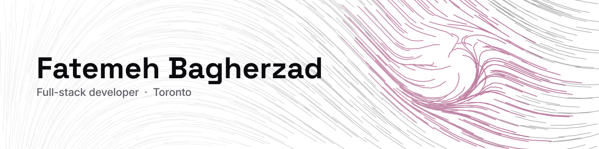

<picture>
  <source media="(prefers-color-scheme: dark)" srcset="banner-dark.svg">
  
</picture>

Full-stack developer in Toronto. React, JavaScript, Python, and directing AI
coding agents against specifications I write.

I build complex interactive interfaces — multilingual, right-to-left,
accessible, mobile-first — and design the APIs and data models behind them.

---

### What I'm building

**[Rabva](https://github.com/FatemeBagherzad/Rabva)** — a Quran study platform
for readers, memorizers and researchers, in English, Persian and Arabic.

- A reading view that scrolls continuously through all **6,236 verses** on
  ayah-anchored pagination, with per-scroll work kept proportional to what is
  visible so low-memory phones stay responsive
- A research canvas with pan, zoom, drag, marquee selection and node-to-node
  connections, built on pointer events — with full parity between mouse, touch
  and keyboard, and nothing that needs a mouse
- **210+ React components**, 40 custom hooks, an SCSS design-token system
  driving user-selectable themes, and **270+ aria-labelled controls**
- A Django REST API of **14 domain modules, 92 models and 170+ documented
  endpoints** — I wrote the data model and the endpoint contracts, then
  directed AI agents to implement them inside standards, tests and review
  gates I defined
- Eight Docker services on AWS EC2 provisioned with Terraform, and **115
  Playwright spec files / 500+ tests across six browser profiles** running
  before every push

I write up the parts that were genuinely hard — Arabic shaping that differs
between Safari and Chrome, utf8mb4 corruption hiding inside a plain
`mysqldump`, designing query paths that still work at a billion rows — as
**[engineering deep dives](https://fateme-bagherzad-portfolio.netlify.app/deep-dives)**.

---

### What I work with

**Proficient** — JavaScript (ES6+), React 18, HTML5, CSS3, SCSS, mobile-first
responsive and RTL layout, accessibility, Node.js, Express, SQL/MySQL,
Knex.js, REST APIs, OpenAPI/Swagger, Docker and Docker Compose, Git, Vite

**Also work with** — TypeScript, Python, Django REST Framework, Playwright,
Jest, Linux, Nginx, AWS EC2, Terraform, Redis, GitHub Actions

**AI-assisted development** — Claude Code, GitHub Copilot, MCP servers, agent
instruction and skills design, parallel agent workflows, context engineering,
automated review gating (Aikido, SonarQube, Snyk)

---

### Before this

Nine years as a 2D/3D technical designer in Tehran, finishing as design lead,
writing scripts to automate the repetitive parts of rendering — which is still
how I work when something is slow or repeated. A bachelor's in pure
mathematics, then BrainStation's software engineering diploma at a 94%
average, and back the following year as a teaching assistant.

---

### Open to

Full-time front-end or full-stack roles in Toronto or remote.

[Portfolio](https://fateme-bagherzad-portfolio.netlify.app/) ·
[LinkedIn](https://www.linkedin.com/in/fatemeh-bagherzad/) ·
fa.bagherzad@gmail.com
